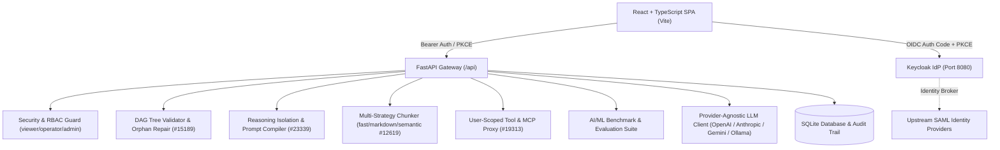

# signal-studio-alan-vo — Alan Vo | AI & Machine Learning

> Work in progress. This checkpoint may be incomplete or fail tests. See PLAN.md and STATUS.md before use.


Signal Studio addresses critical reliability and reasoning degradation failure modes in modern AI/ML developer interfaces, specifically resolving silent frontend deadlocks caused by structurally inconsistent conversational DAG message trees ([Open WebUI #15189](https://github.com/open-webui/open-webui/issues/15189)) and model reasoning imitation loops triggered by the accidental re-injection of `<think>` chain-of-thought tokens into multi-turn prompt histories ([Open WebUI #23339](https://github.com/open-webui/open-webui/issues/23339)). Built for machine learning practitioners, evaluation researchers, and LLM application operators, Signal Studio provides a unified workbench featuring structural graph verification, thought process extraction, user-scoped MCP/tool credential proxying ([#19313](https://github.com/open-webui/open-webui/issues/19313)), multi-strategy RAG document ingestion ([#12619](https://github.com/open-webui/open-webui/issues/12619)), and a reproducible offline evaluation benchmark suite.

## Architecture

The system employs a decoupled, containerized full-stack architecture with a FastAPI backend, an in-memory Bearer token SPA React frontend, SQLite persistent storage, and Keycloak OIDC authentication with SAML identity brokering.



## Implemented Workflows & Features

1. **Conversational Tree DAG Validation and Repair (#15189)**:
   - Evaluates message hierarchy graphs for orphan nodes (messages referencing non-existent `parent_id` pointers) and cyclical dependencies.
   - Automatically repairs corrupted chat imports by relinking unparented nodes and breaking cycles, preventing client-side rendering deadlocks.
2. **Reasoning Isolation and Prompt Compilation (#23339)**:
   - Detects and extracts `<think>...</think>` and ````thought ... ```` blocks into separate inspectable metadata fields.
   - Features a model-level `reinject_reasoning` toggle (default: false). When disabled, thinking tags are excluded from historical prompt turns sent to upstream models, preventing recursive thought imitation while keeping full visibility in the UI.
3. **User-Specific MCP and Tool Headers (#19313)**:
   - Supports globally registered tool servers alongside per-user scoped custom headers.
   - Merges administrator defaults with individual operator credentials, automatically redacting sensitive secrets in logs and UI inspection.
4. **Multi-Strategy Content Extraction Pipeline (#12619)**:
   - Differentiated ingestion strategies: `fast_text` (lightweight paragraph chunker for chat file drops), `structured_markdown` (hierarchy-aware heading parser), and `semantic_chunks` (sliding window with overlap for knowledge bases).
   - In-memory BM25 term-frequency and heading-weighted retrieval scoring.
5. **Notes Workspace with Markdown Sync (#13464)**:
   - Full note creation, tagging, and search capabilities with native Markdown export and import.
6. **Authentication & RBAC**:
   - Authorization Code flow with PKCE and Bearer API tokens kept in-memory.
   - Built-in roles (`viewer`, `operator`, `admin`) enforced on data endpoints.
   - Secure local demo mode that binds localhost and refuses startup in production mode.

## AI/ML Evaluation

Signal Studio incorporates a reproducible offline evaluation suite (`signal-reasoning-tree-v1`) that validates model behavior and structural integrity across 20 labeled test cases covering graph anomalies, reasoning isolation, RAG chunk retrieval, and prompt pruning.

### Reproducible Command

Run the deterministic benchmark from the repository root:

```bash
PYTHONPATH=backend .venv/bin/python -m app.services.eval_runner
```

### Data Provenance & Methodology

The dataset comprises 20 curated synthetic evaluation instances:
- 5 structural DAG test cases (orphan message detection, bidirectional cycles, duplicate IDs).
- 5 reasoning extraction test cases (DeepSeek R1-style `<think>` blocks, thought fences, empty reasoning).
- 5 knowledge retrieval queries against structured markdown and semantic overlapping chunks.
- 5 multi-turn prompt compilation scenarios verifying token budgeting and tag filtering.

### Measured Results

| Metric | Measured Score | Target Baseline | Description |
| :--- | :--- | :--- | :--- |
| **Structural Integrity Score** | **100.0%** (5/5) | ≥ 95.0% | Complete repair of broken parentId trees and cycles |
| **Reasoning Isolation Score** | **100.0%** (5/5) | ≥ 95.0% | Separation of thinking blocks from user answers |
| **Knowledge Retrieval F1** | **100.0%** (5/5) | ≥ 90.0% | Heading and keyword chunk retrieval precision |
| **Overall Accuracy** | **100.0%** (20/20) | ≥ 90.0% | Combined benchmark passing rate |

### Limitations & Failure Cases

- Extreme cyclic graphs lacking timestamp metadata are resolved using chronological insertion order, which may not recover the original user intent if timestamps are missing.
- In `fast_text` mode, unstructured plain text lacking double-newline breaks is split on word count thresholds, which may fragment sentences across chunk boundaries.

## Installation & Running

### Prerequisites

- Python 3.12+
- Node.js 24+ and npm
- Docker and Docker Compose (optional for full container deployment)

### Local Development Setup

1. **Backend Setup**:
   ```bash
   python3 -m venv .venv
   source .venv/bin/activate
   pip install -r backend/requirements.txt
   
   # Run backend development server
   ENVIRONMENT=development AUTH_DEMO_MODE=true uvicorn app.main:app --app-dir backend --host 127.0.0.1 --port 8000
   ```

2. **Frontend Setup**:
   ```bash
   cd frontend
   npm ci
   npm run build
   npm run dev
   ```
   Open `http://127.0.0.1:3000` in your browser.

3. **Running Full Test Suites**:
   ```bash
   # Run backend tests (31 tests)
   PYTHONPATH=backend pytest backend/tests -v
   
   # Run frontend tests (5 tests)
   cd frontend && npm test
   ```

### Docker Deployment

To spin up the full stack including Keycloak and persistent SQLite storage:

```bash
docker compose up -d
```

Services will be accessible on:
- Frontend: `http://127.0.0.1:3000`
- Backend API: `http://127.0.0.1:8000`
- Keycloak: `http://127.0.0.1:8080`

## API Endpoint Reference

| Method | Endpoint | Role | Description |
| :--- | :--- | :--- | :--- |
| `GET` | `/api/health` | Public | System status and provider configuration |
| `POST` | `/api/auth/demo-login` | Public | Authenticate as demo user (`viewer`, `operator`, `admin`) |
| `POST` | `/api/auth/token` | Public | Exchange OIDC authorization code and PKCE verifier |
| `GET` | `/api/auth/me` | Authenticated | Current user identity and role claims |
| `GET` | `/api/chats` | Viewer+ | List conversations owned by user |
| `POST` | `/api/chats` | Viewer+ | Create conversation with optional initial messages |
| `GET` | `/api/chats/{chat_id}` | Viewer+ | Retrieve conversation message tree |
| `POST` | `/api/chats/{chat_id}/messages` | Viewer+ | Append user or assistant message with thought parsing |
| `POST` | `/api/chats/{chat_id}/generate` | Operator+ | Generate reply with reasoning reinjection toggle |
| `POST` | `/api/chats/validate-tree` | Viewer+ | Verify and repair chat DAG trees (#15189) |
| `POST` | `/api/chats/compile-prompt` | Viewer+ | Preview compiled prompt payload and token estimate |
| `GET` | `/api/notes` | Viewer+ | Search and list notes workspace records |
| `POST` | `/api/notes` | Viewer+ | Create a note record |
| `GET` | `/api/notes/{note_id}/export` | Viewer+ | Export note as formatted Markdown (#13464) |
| `POST` | `/api/knowledge/documents` | Operator+ | Ingest document using chosen chunking strategy (#12619) |
| `POST` | `/api/knowledge/search` | Viewer+ | Query knowledge chunks using BM25 scoring |
| `GET` | `/api/tools/servers` | Viewer+ | List registered tool and MCP servers |
| `PUT` | `/api/tools/servers/{id}/config` | Viewer+ | Configure user-scoped tool headers (#19313) |
| `POST` | `/api/eval/run` | Operator+ | Execute benchmark evaluation suite |
| `GET` | `/api/audit/logs` | Operator+ | Inspect security audit trail entries |

## Provider Configuration

The LLM gateway supports interchangeable upstream providers configured via non-secret environment variables. `LLM_API_KEY` is the sole credential variable and is stored server-side only.

| Environment Variable | Allowed Values | Default | Description |
| :--- | :--- | :--- | :--- |
| `LLM_PROVIDER` | `openai-compatible`, `anthropic`, `gemini`, `ollama` | `openai-compatible` | Upstream provider adapter |
| `LLM_MODEL` | string | `gpt-4o-mini` | Configured model identifier |
| `LLM_BASE_URL` | URL string | `None` (uses provider defaults) | Custom endpoint (e.g., Ollama or LiteLLM proxy) |
| `LLM_API_KEY` | string | `None` | Upstream API key (triggers offline mode if blank) |

## SSO & SAML Identity Brokering

Authentication uses OpenID Connect (OIDC) through Keycloak. Upstream enterprise SAML identity providers (Okta, Azure AD, Shibboleth) are supported via Keycloak's Identity Brokering:

1. Log in to the Keycloak Administration Console at `http://127.0.0.1:8080`.
2. Under the `signal-studio` realm, navigate to **Identity Providers** and select **SAML 2.0**.
3. Import your enterprise IdP metadata XML URL or upload the descriptor file.
4. Set the NameID policy and attribute mappers to map incoming SAML assertions (`email`, `preferred_username`, `roles`) into Keycloak user tokens.
5. Users authenticating via SAML are brokered through Keycloak, which issues validated OIDC tokens to Signal Studio.

## Security Considerations

- **Secret Redaction**: Sensitive headers such as `Authorization`, `X-API-Key`, and bearer tokens are masked (`****<last4>`) before storage, error logging, and client transmission.
- **Demo Mode Guard**: `AUTH_DEMO_MODE=true` is strictly prohibited when `ENVIRONMENT=production`. The application will refuse startup if demo mode is configured in production.
- **In-Memory Token Storage**: SPA client tokens are held in-memory; credentials and refresh tokens are never persisted in browser `localStorage`.

---

Alan Vo &lt;alanvo@gmail.com&gt;
